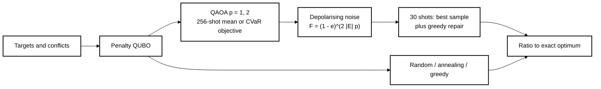
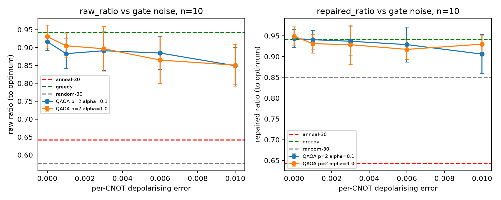
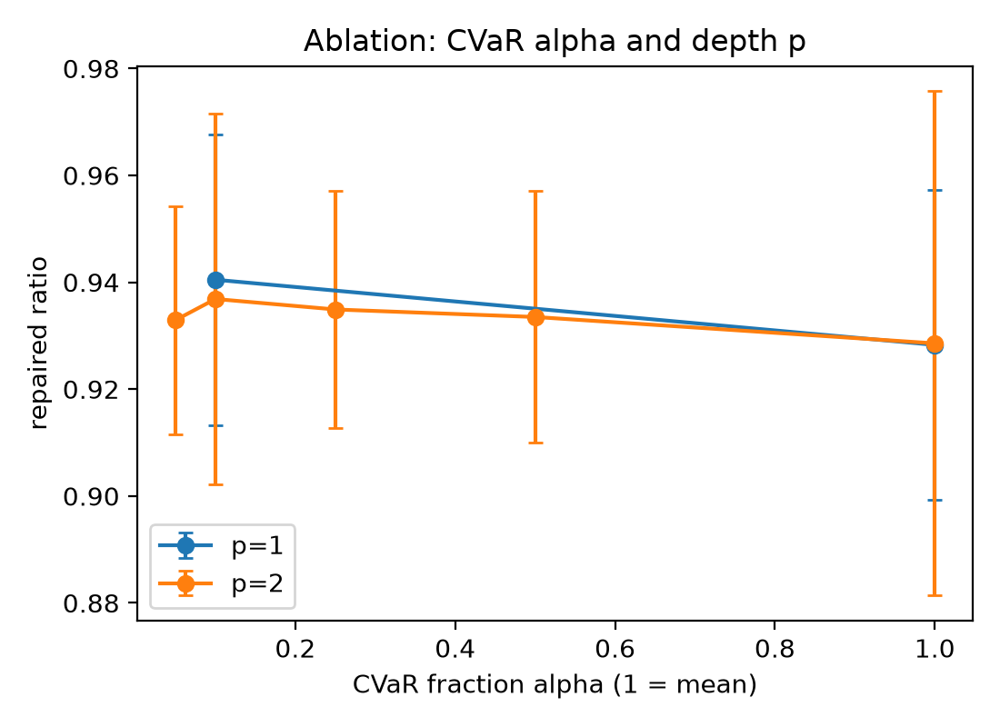
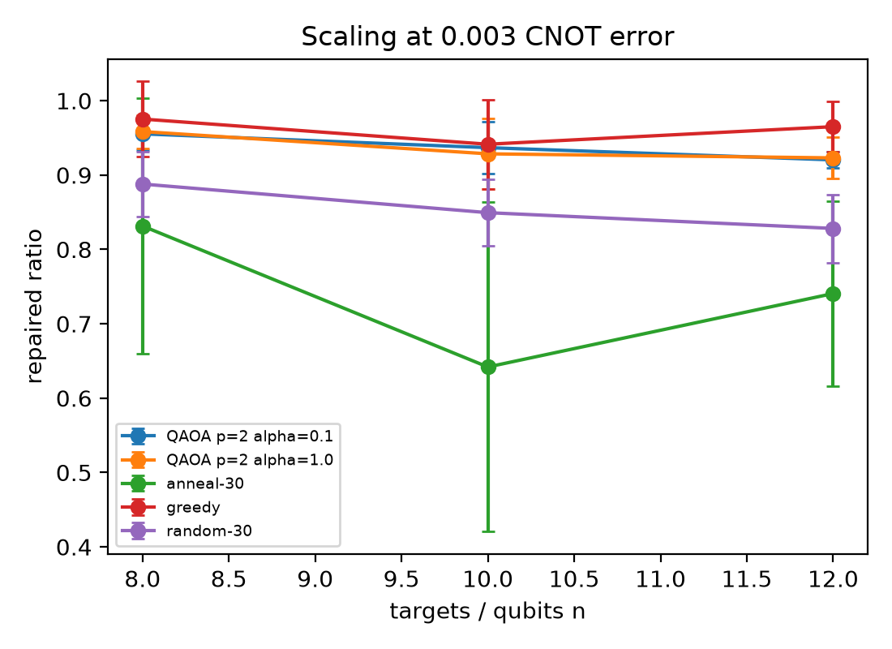

# satellite-scheduling-qaoa-cvar-noise

[](LICENSE)

[](https://github.com/pradeepdegalaroyal/satellite-scheduling-qaoa-cvar-noise/actions)

**Abstract.** This simulation study asks whether training QAOA with a CVaR objective helps Earth-observation scheduling (max-weight independent set on a conflict graph) when training uses finite shots and gate noise grows with graph density. On n=8-12 qubits and 5 instances, QAOA beats random sampling and simulated annealing at a matched 30-sample budget, but CVaR gives no measurable gain over the plain expectation, and a simple greedy heuristic is as good or better. The hypothesis is therefore not supported; the repository provides a reproducible noise-aware benchmark harness.

## Motivation and gap
Blekos et al. (2024, doi:10.1016/j.physrep.2024.03.002) and Abbas et al. (2024, doi:10.1038/s42254-024-00770-9) call for noise-aware, systematic benchmarking of QAOA; Brandhofer et al. (2023, doi:10.1007/s11128-022-03766-5) show that shot and gate noise are practical issues for constrained QAOA. Space-technology scheduling is a natural target, but its behaviour at a small sample budget against strong classical baselines is rarely reported. See [docs/RESEARCH_GAP.md](docs/RESEARCH_GAP.md) and [docs/METHOD.md](docs/METHOD.md).

## Method

Noise is a global-depolarising approximation (mixing with the uniform distribution at the circuit fidelity), not a gate-level simulation.

## Results (5 instances, mean ± std; from `results/summary.csv`)
Noise sweep, n=10, best of 30 shots, repaired ratio (raw ratio in brackets):

| CNOT error | QAOA mean (alpha=1) | QAOA CVaR (alpha=0.1) |
|---|---|---|
| 0 | 0.949 ± 0.023 (0.931 ± 0.032) | 0.943 ± 0.022 (0.916 ± 0.025) |
| 0.001 | 0.931 ± 0.022 (0.905 ± 0.033) | 0.941 ± 0.023 (0.883 ± 0.042) |
| 0.003 | 0.929 ± 0.047 (0.897 ± 0.062) | 0.937 ± 0.035 (0.891 ± 0.055) |
| 0.006 | 0.917 ± 0.024 (0.865 ± 0.065) | 0.929 ± 0.042 (0.885 ± 0.046) |
| 0.01 | 0.930 ± 0.022 (0.851 ± 0.058) | 0.906 ± 0.047 (0.849 ± 0.051) |

Classical baselines, n=10: random-30 0.849 ± 0.044 repaired (0.575 ± 0.061 raw); annealing-30 0.642 ± 0.221; greedy 0.941 ± 0.060.

Scaling at 0.003 CNOT error, repaired ratio (QAOA alpha=1 / QAOA alpha=0.1 / greedy / random-30): n=8 0.958 / 0.955 / 0.975 / 0.888; n=10 0.929 / 0.937 / 0.941 / 0.849; n=12 0.923 / 0.920 / 0.965 / 0.828. QAOA feasible probability mass at n=12 is 0.360 (alpha=1) versus 0.025 for uniform sampling.

  

## Discussion
- QAOA concentrates probability on feasible schedules (n=10, no noise: feasible mass 0.611 versus 0.063 uniform) and beats random sampling and annealing at 30 samples.
- **Hypothesis not supported:** CVaR alpha=0.1 is within one standard deviation of the expectation objective at every noise level, and is lower at e=0.01 on the repaired metric. The alpha ablation is flat (repaired 0.929-0.937 for p=2).
- Depth p=2 over p=1 gives no clear gain at e=0.003 (p=1: 0.928 for alpha=1, 0.940 for alpha=0.1).
- Greedy matches or beats QAOA at every size; no quantum advantage is claimed.
- Gate noise lowers the raw ratio (0.931 to 0.851 for alpha=1) and the feasible mass (0.611 to 0.300), while greedy repair hides most of the loss, so reporting only repaired ratios would overstate hardware robustness.

## Limitations
Exact statevector with n<=12; global-depolarising noise with all-to-all connectivity (no routing, readout or coherent errors); synthetic instances; a 30-shot budget chosen so that sampling is not trivially exhaustive at this size; 5 instances give wide error bars; a single optimiser (COBYLA, 60 iterations).

## Future work
Gate-level noisy simulation or hardware runs with transpiled depth, realistic orbital pass and visibility instances, larger n with MPS or sampling-based estimators, warm-started and constraint-preserving mixers, and comparison with stronger classical solvers.

## Reproducibility
```
pip install -r requirements.txt
pip install -e .
pytest -q
python experiments/run_all.py          # about 1 minute (55 s measured); writes results/ and figures/
python experiments/run_all.py --quick  # smoke run, a few seconds; writes results_quick/
```
Hardware: Windows 11, Python 3.11.9, CPU only (NumPy).

## Related work by the author
[qaoa-best-of-k-sampling-noise](https://github.com/pradeepdegalaroyal/qaoa-best-of-k-sampling-noise), [xy-mixer-vs-penalty-qaoa-noise-crossover](https://github.com/pradeepdegalaroyal/xy-mixer-vs-penalty-qaoa-noise-crossover).

## Structure
`src/satqaoa/` (problem, qaoa, baselines), `experiments/run_all.py`, `tests/`, `docs/`, `results/`, `figures/`.

## Citation
If you use this code, please cite it (see also [CITATION.cff](CITATION.cff)):

```bibtex
@software{chenchupradeep2026satqaoa,
  author  = {Chenchupradeep, Degala},
  title   = {Satellite observation scheduling with QAOA: mean versus CVaR objectives under gate noise},
  year    = {2026},
  version = {0.1.0},
  url     = {https://github.com/pradeepdegalaroyal/satellite-scheduling-qaoa-cvar-noise},
  license = {MIT}
}
```

MIT license (`LICENSE`).
